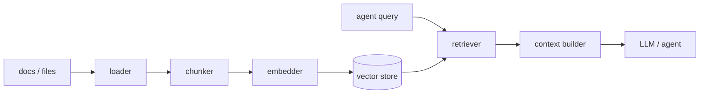

# easy-rag-for-agent

A minimal, opinionated RAG (retrieval-augmented generation) setup meant to be dropped into an
agent's toolbox — ingest documents, embed them, retrieve the relevant chunks, and hand them to
the model.

> **Status:** just scaffolded. No code yet. This README will grow into install, usage, and demo
> sections as the project does.

## Planned shape

## Roadmap

- [ ] Loaders for plain text, Markdown, and PDF
- [ ] Configurable chunking strategy
- [ ] Pluggable embedding + vector store backends
- [ ] Retrieval helpers an agent can call as a tool
- [ ] End-to-end example

## Requirements

Nothing to install yet.

## License

Not chosen yet.
