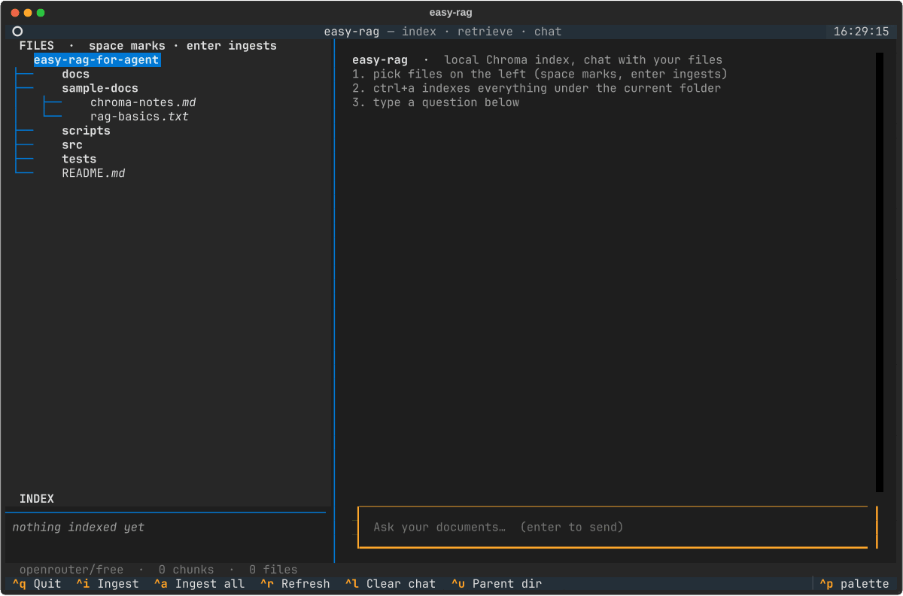
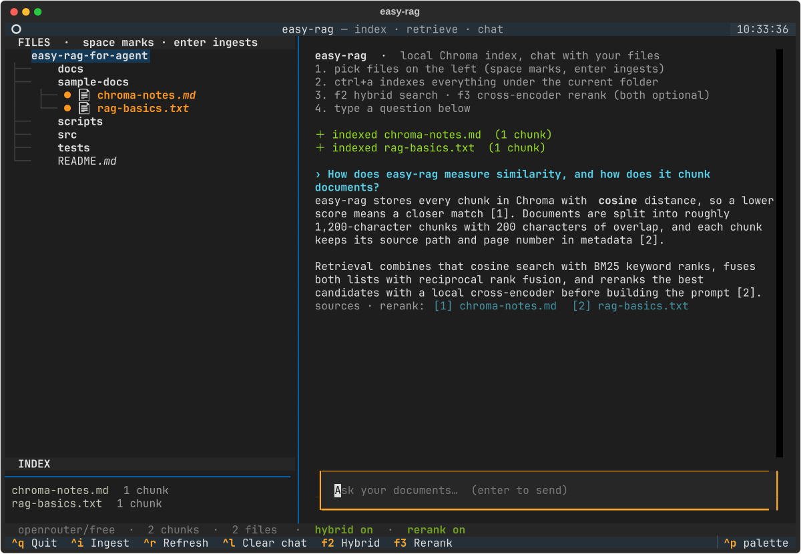
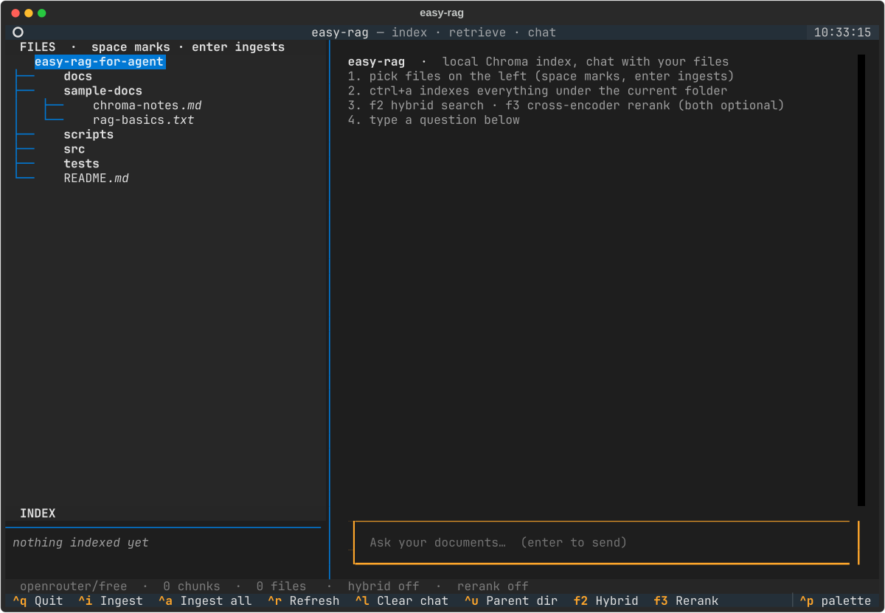
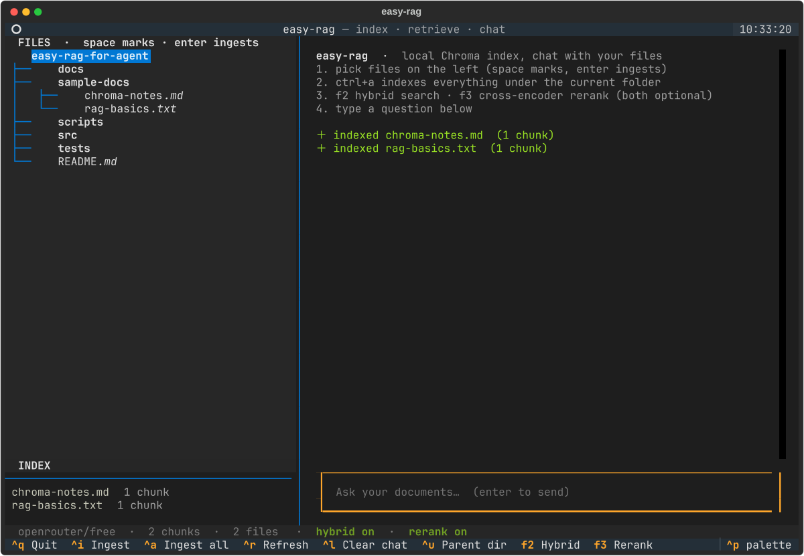
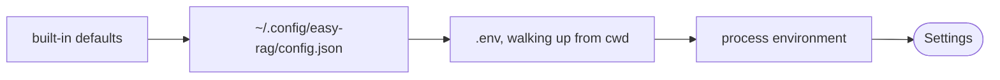
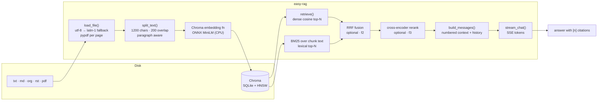
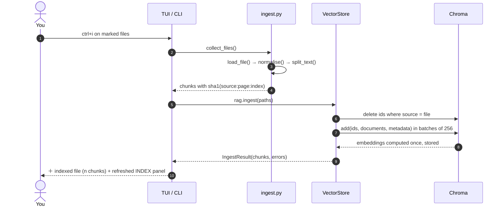
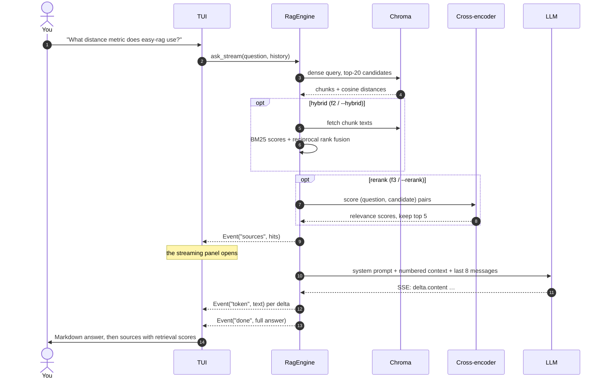
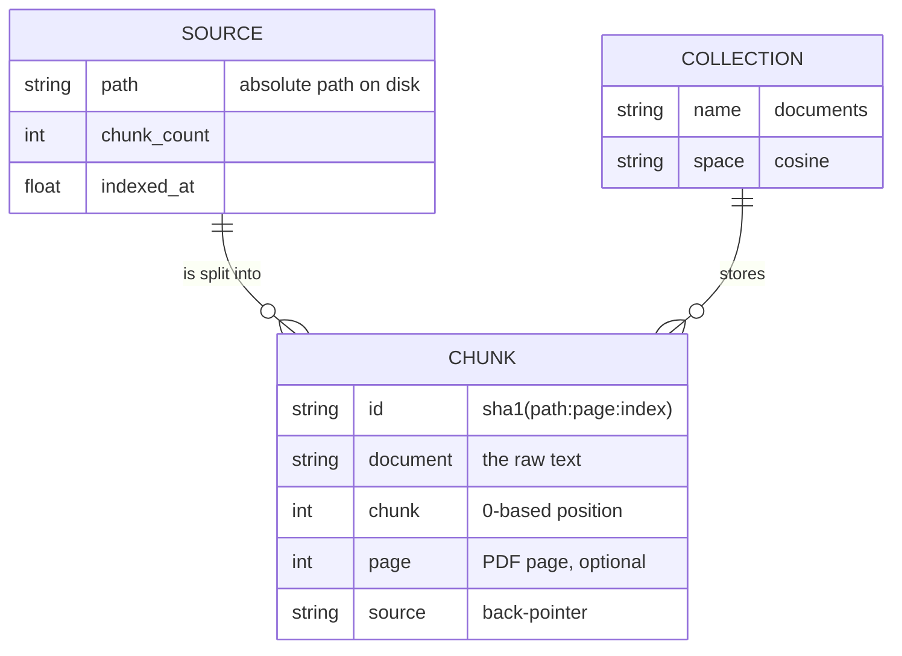
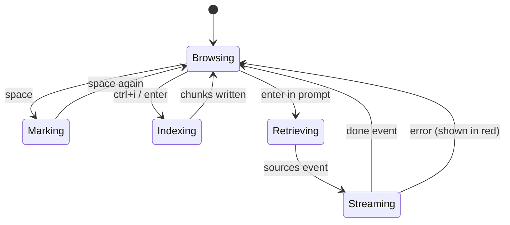

<p align="center">
  
</p>

<h1 align="center">easy-rag</h1>

<p align="center">
  A local-first RAG workbench that lives in your terminal.<br>
  Browse your files, index them into Chroma, and chat with them — no browser, no daemon, no glue code.
</p>

<p align="center">
  <a href="https://github.com/Abdulhadi446/easy-rag-for-agent/stargazers"></a>
  
  <a href="https://textual.textualize.io/"></a>
  <a href="https://www.trychroma.com/"></a>
  
  <a href="LICENSE"></a>
  <a href="https://openrouter.ai/"></a>
</p>

---

## Why this exists

Most RAG demos are a notebook, a vector database you have to host, and a web UI you have to
babysit. **easy-rag** is the opposite: one `uv run` away from a finished tool. It ships its own
file explorer, its own indexer, and its own chat, all rendered with
[Textual](https://textual.textualize.io/) inside the terminal you already have open.

- **Everything is local** except the final chat completion. Files never leave your machine
  until the relevant chunks are sent to the model you configured.
- **No GPU, no Ollama, no local LLM.** Embeddings run on CPU through Chroma's bundled ONNX
  MiniLM model; the chat model is any OpenAI-compatible endpoint.
- **Citations built in.** Every answer is grounded in numbered chunks and shows the source files
  (with retrieval scores) underneath.
- **Dense, hybrid or reranked.** Toggle BM25 + dense fusion and a local cross-encoder reranker
  from the TUI or the CLI — no API key and no second service.
- **Two ways to drive it.** A full TUI with a mouse-free file explorer, and a scriptable CLI for
  agents and cron jobs.

```
❯ easy-rag
┌─ FILES ──────────────────────┬─ CHAT ─────────────────────────────────────────┐
│ ● chroma-notes.md            │ › How does easy-rag measure similarity?        │
│ ● rag-basics.txt             │ easy-rag uses cosine distance in Chroma, so a  │
│   README.md                  │ lower score means a closer match [1].          │
│                              │ sources · rerank: [1] chroma-notes.md          │
└──────────────────────────────┴────────────────────────────────────────────────┘
 openrouter/free · 2 chunks · 2 files · hybrid on · rerank on
```

## Screenshots

<p align="center">
  
</p>

<details>
<summary><b>More screenshots — marking files and the index panel</b></summary>
<br>
<p align="center">
  
</p>
<p align="center">
  
</p>
</details>

---

## Quick start

### 1. Clone and install

```bash
git clone https://github.com/Abdulhadi446/easy-rag-for-agent.git
cd easy-rag-for-agent
uv sync
```

<details>
<summary>Prefer pip / an isolated global command?</summary>

```bash
python -m venv .venv && source .venv/bin/activate
pip install -e .
# or install it once, globally:
uv tool install .
```

The `easy-rag` console script is what you get either way.
</details>

### 2. Add a model key

```bash
cp .env.example .env
$EDITOR .env          # set OPENROUTER_API_KEY=...
```

Any OpenAI-compatible endpoint works — OpenRouter, OpenAI, Groq, LM Studio, vLLM, Ollama's
`/v1` shim. The only hard requirement is a `/chat/completions` endpoint that supports streaming.

```dotenv
OPENROUTER_API_KEY=sk-or-v1-…
MODEL=openrouter/free

# point somewhere else if you like
# EASYRAG_BASE_URL=https://api.openai.com/v1
# MODEL=gpt-4o-mini
```

### 3. Index something and ask

```bash
uv run easy-rag add sample-docs
uv run easy-rag ask "What distance metric does easy-rag use?"
uv run easy-rag ask --hybrid --rerank "How does retrieval work?"
```

Or just open the workbench and do it visually:

```bash
uv run easy-rag
```

> **First run downloads two models.** Chroma fetches its ~80 MB ONNX embedding model once.
> The first time you enable reranking, easy-rag also fetches a ~23 MB quantized cross-encoder.
> Both are cached, and everything runs on the CPU.

---

## The terminal interface

The left third is a real directory tree. The right side is the conversation.

| Key | Action |
| --- | --- |
| <kbd>↑</kbd> <kbd>↓</kbd> / type | Move through folders, expand with <kbd>→</kbd> |
| <kbd>space</kbd> | Mark / unmark a file (yellow ●) |
| <kbd>enter</kbd> | Index the highlighted file, or fold/unfold a folder |
| <kbd>ctrl</kbd>+<kbd>i</kbd> | Index every marked file (or the cursor target if nothing is marked) |
| <kbd>ctrl</kbd>+<kbd>a</kbd> | Index everything supported under the current root |
| <kbd>ctrl</kbd>+<kbd>r</kbd> | Reload the tree and the index panel |
| <kbd>ctrl</kbd>+<kbd>l</kbd> | Clear the chat and conversation memory |
| <kbd>ctrl</kbd>+<kbd>u</kbd> | Go to the parent directory |
| <kbd>f2</kbd> | Toggle hybrid search (dense + BM25, fused with RRF) |
| <kbd>f3</kbd> | Toggle cross-encoder reranking (loads the local model on first use) |
| <kbd>ctrl</kbd>+<kbd>q</kbd> | Quit |

The **INDEX** panel lists every source already in the collection and how many chunks it
contributed, so you can tell at a glance what the model can actually see. Files that have been
deleted from disk show up red and marked `missing`.

Re-ingesting a file replaces its old chunks instead of duplicating them — the UI is safe to
hammer while you edit notes.

## Retrieval modes

Three stages sit between your question and the prompt. Dense search is always on; the other two
are independent switches, **off by default**.

| Stage | TUI | CLI | What it does |
| --- | --- | --- | --- |
| Dense | always | always | Chroma cosine similarity over the whole collection |
| Hybrid | <kbd>f2</kbd> | `--hybrid` / `--no-hybrid` | BM25 over every chunk, fused with the dense ranking by reciprocal rank fusion |
| Rerank | <kbd>f3</kbd> | `--rerank` / `--no-rerank` | Scores each of the 20 candidates against the question with a local cross-encoder, keeps the best 5 |

The status bar shows `hybrid on/off` and `rerank on/off`, and the source line says which score
produced the final order (`distance`, `rrf` or `rerank`). TUI toggles apply to the current
session; persist a default with:

```bash
easy-rag config --set hybrid=on
easy-rag config --set rerank=on
# or start the TUI with overrides for one run:
easy-rag tui --hybrid --rerank
```

Hybrid is the biggest win for names, error codes, config keys and acronyms. Reranking is the
biggest win when dense retrieval returns several plausible chunks but the right one is buried at
position 8 or 12.

## Command line

```bash
easy-rag                          # open the TUI in the current folder
easy-rag --path ~/notes           # open the TUI somewhere else
easy-rag add ~/notes ~/papers/x.pdf
easy-rag ask "Summarise the architecture" -k 8
easy-rag ask --hybrid --rerank "What does the HNSW config change?"
easy-rag ask --no-hybrid --no-rerank "Plain dense search"   # override config for one call
easy-rag ls                       # what is indexed
easy-rag rm chroma-notes.md       # drop one source
easy-rag reset                    # wipe the collection
easy-rag doctor                   # check key, database, embeddings
easy-rag config --show
easy-rag config --set model=gpt-4o-mini
```

<details>
<summary><b>Sample output</b></summary>

```console
$ easy-rag add sample-docs
  + /home/you/easy-rag-for-agent/sample-docs/chroma-notes.md  (1 chunk)
  + /home/you/easy-rag-for-agent/sample-docs/rag-basics.txt  (1 chunk)
2 files, 2 chunks indexed

$ easy-rag ask --hybrid --rerank "What distance metric does easy-rag use?"
easy-rag stores chunks in Chroma with cosine distance, so a lower score means a closer
match [1].

sources:
  [1] chroma-notes.md  (rerank 0.8971)

$ easy-rag ls
   1 chunk  /home/you/easy-rag-for-agent/sample-docs/chroma-notes.md
   1 chunk  /home/you/easy-rag-for-agent/sample-docs/rag-basics.txt

2 sources, 2 chunks  ·  /home/you/.local/share/easy-rag/chroma

$ easy-rag doctor
config dir   /home/you/.config/easy-rag
data dir     /home/you/.local/share/easy-rag
database     /home/you/.local/share/easy-rag/chroma
env file     /home/you/easy-rag-for-agent/.env
model        openrouter/free
base url     https://openrouter.ai/api/v1
api key      set (sk-or-…)
retrieval    hybrid on  ·  rerank on (Xenova/ms-marco-MiniLM-L-6-v2)  ·  top 5 of 20
chroma       ok, 2 chunks, 2 sources
embeddings   testing (first run downloads a 80MB ONNX model)…
embeddings   ok
```
</details>

## Configuration

Settings resolve in this order (last one wins):



| Variable | Default | Meaning |
| --- | --- | --- |
| `EASYRAG_API_KEY` / `OPENROUTER_API_KEY` / `OPENAI_API_KEY` | — | Bearer token for the chat endpoint |
| `EASYRAG_BASE_URL` | `https://openrouter.ai/api/v1` | OpenAI-compatible base URL |
| `EASYRAG_MODEL` / `MODEL` | `openrouter/free` | Model id sent to that endpoint |
| `EASYRAG_DB` | `~/.local/share/easy-rag/chroma` | Chroma persistence directory |
| `EASYRAG_COLLECTION` | `documents` | Collection name (3–512 chars) |
| `EASYRAG_CHUNK_SIZE` | `1200` | Characters per chunk |
| `EASYRAG_CHUNK_OVERLAP` | `200` | Characters shared by neighbours |
| `EASYRAG_TOP_K` | `5` | Chunks retrieved per question |
| `EASYRAG_CANDIDATES` | `20` | Candidate pool per retriever before reranking |
| `EASYRAG_HYBRID` | `off` | Fuse dense and BM25 rankings with RRF |
| `EASYRAG_RERANK` | `off` | Rerank the candidate pool with a cross-encoder |
| `EASYRAG_RERANK_MODEL` | `Xenova/ms-marco-MiniLM-L-6-v2` | ONNX cross-encoder (Hugging Face id or local export directory) |
| `EASYRAG_CACHE_DIR` | `~/.cache/easy-rag` | Where reranker weights are cached |
| `EASYRAG_MAX_TOKENS` | `1600` | Answer budget |
| `EASYRAG_TEMPERATURE` | `0.2` | Sampling temperature |
| `EASYRAG_TIMEOUT` | `180` | HTTP timeout in seconds |

Anything you set with `easy-rag config --set key=value` is written to
`~/.config/easy-rag/config.json`; `easy-rag config --show` prints the effective values with the
key masked.

## How it works

### The pipeline



When a toggle is off, its stage passes the previous ranking straight through: dense-only uses
cosine order, and hybrid-without-rerank keeps the fused order.

### Indexing a file



### Asking a question



### Data model



### UI state machine



### Design choices

| Decision | Why |
| --- | --- |
| Chroma's default ONNX MiniLM embeddings | Zero setup, CPU-only, no embedding API bills |
| Cosine distance | Scale-free and stable for sentence embeddings; lower = closer |
| Character-based chunking | Predictable cost across languages, no tokenizer dependency |
| Delete-then-add per source | Re-indexing is idempotent; no duplicate chunks |
| sha1(`source:page:index`) ids | Deterministic ids make the delete above trivial |
| SSE parsing that ignores `reasoning` | Free routers stream chain-of-thought before the answer |
| Hybrid search via RRF | Exact terms, acronyms and identifiers survive when embeddings drift; RRF needs no score calibration |
| Local cross-encoder reranker | Real query-document relevance on CPU, no API key, 23 MB quantized model |
| 20-candidate pool | Enough for a second stage to fix ordering without slow CPU reranking |
| 12k-character context cap | Keeps prompts small enough for free tiers |
| Last 8 messages of history | Follow-up questions without unbounded prompt growth |

## Project layout

```
easy-rag-for-agent/
├── src/easyrag/
│   ├── config.py        # Settings, .env + config.json resolution, masking
│   ├── ingest.py        # loaders, normalisation, paragraph-aware chunking
│   ├── search.py        # BM25 tokenizer, lexical ranking, reciprocal rank fusion
│   ├── reranker.py      # lazy ONNX cross-encoder, no torch
│   ├── store.py         # Chroma wrapper: ingest, dense + hybrid query, sources
│   ├── llm.py           # OpenAI-compatible streaming client (httpx + SSE)
│   ├── rag.py           # retrieval modes, prompt construction, ask_stream
│   ├── cli.py           # argparse entry point for every subcommand
│   └── tui/
│       └── app.py       # Textual app: FileTree, RichLog chat, workers
├── tests/               # 45 tests: ingest, store, search, rerank, SSE, TUI pilot
├── sample-docs/         # tiny corpus to try the app with
├── scripts/             # demo capture + GIF rendering
└── docs/demo/           # generated screenshots and demo.gif
```

## Development

```bash
uv sync --extra dev
uv run pytest -q            # 45 passed
uv run easy-rag --version
```

The test suite covers chunking edge cases, idempotent re-ingestion, delete-by-source, BM25 and
rank fusion, the reranking pipeline with an injected scorer, SSE parsing with a mocked transport
(including reasoning deltas and error events), prompt assembly, and a real Textual pilot that
types into the chat and toggles both retrieval modes.

### Regenerating the demo assets

The GIF and screenshots in this README are generated, not hand-made:

```bash
uv run python scripts/demo_capture.py --size 126x40   # drives the real TUI, writes SVG frames
./scripts/render_demo.sh                              # SVG → PNG stills + docs/demo/demo.gif
```

`demo_capture.py` uses a throwaway Chroma database, indexes `sample-docs/` for real, and swaps in
a scripted model stream so the capture is deterministic and offline.

## Troubleshooting

| Symptom | Fix |
| --- | --- |
| `FreeUsageLimitError` / `Insufficient balance` | Your provider quota is used up. Switch `MODEL`, add credits, or point `EASYRAG_BASE_URL` at a local server. |
| `401` from the chat endpoint | Check the key in `.env`; `easy-rag doctor` prints whether it was found. |
| First ingest hangs for a minute | Chroma is downloading the ONNX embedding model (~80 MB). It is cached afterwards. |
| `no .md, .txt or .pdf files found` | The folder only had hidden files or unsupported extensions. |
| Answers ignore your newest notes | Re-ingest the file (`ctrl+i`); retrieval only sees what is in Chroma. |
| Scanned PDFs return nothing | There is no OCR. Run them through `ocrmypdf` first. |
| Collection name error | Chroma requires 3–512 characters for collection names. |
| TUI looks cramped | Resize the terminal; the layout needs roughly 80×24 minimum. |
| First rerank pauses for a few seconds | The ~23 MB cross-encoder is being downloaded and loaded once. It is cached in `~/.cache/easy-rag/models`. |
| `could not download reranker` | Check the network or set `EASYRAG_RERANK_MODEL` to another ONNX export. Hugging Face rate limits are per-IP; setting `HF_TOKEN` raises them. |
| Hybrid search finds nothing useful | BM25 needs literal term overlap. For purely semantic paraphrases, turn f2 off and let dense search do the work. |

## Limitations

- Supported inputs: `.txt`, `.text`, `.md`, `.markdown`, `.org`, `.rst`, `.pdf` (text-based).
- One collection at a time; switching collections means changing `EASYRAG_COLLECTION`.
- The bundled reranker (`ms-marco-MiniLM-L-6-v2`) is English-focused and truncates each
  candidate at 512 tokens.
- BM25 uses a small English stop-word list; other languages still work, just without stop-word
  filtering.
- Hybrid search reads the chunk corpus on each query. That is fine for personal document sets
  (thousands of chunks), not for a shared multi-million-chunk index.
- The chat model must be reachable over HTTP and stream OpenAI-style SSE.

## Roadmap

- [x] Text, Markdown and PDF ingestion
- [x] Persistent Chroma index with idempotent re-indexing
- [x] Internal file explorer TUI with marking and an index panel
- [x] Streaming answers with citations and conversation memory
- [x] CLI for agents (`add`, `ask`, `ls`, `rm`, `reset`, `doctor`, `config`)
- [x] Toggleable hybrid search (BM25 + dense, fused with RRF)
- [x] Toggleable local cross-encoder reranking
- [ ] Multilingual reranker and stemmed BM25
- [ ] Pluggable embedding backends (OpenAI, Ollama) alongside the ONNX default
- [ ] Multiple named collections in the TUI
- [ ] Export a conversation to Markdown

## Built with

[Textual](https://textual.textualize.io/) ·
[Chroma](https://www.trychroma.com/) ·
[Rich](https://rich.readthedocs.io/) ·
[httpx](https://www.python-httpx.org/) ·
[pypdf](https://pypdf.readthedocs.io/) ·
[ONNX Runtime](https://onnxruntime.ai/) ·
[Hugging Face](https://huggingface.co/) ·
[uv](https://docs.astral.sh/uv/)

## License

MIT — see [LICENSE](LICENSE). The sample documents are original and free to reuse. The optional
reranker weights (`ms-marco-MiniLM-L-6-v2`) are downloaded at runtime under their own
Apache-2.0 license.

---

<p align="center">
  <a href="https://github.com/Abdulhadi446/easy-rag-for-agent">github.com/Abdulhadi446/easy-rag-for-agent</a><br>
  <sub>If this saved you an afternoon of wiring, a ⭐ helps.</sub>
</p>
